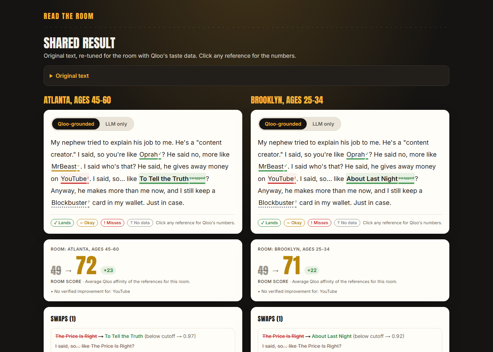
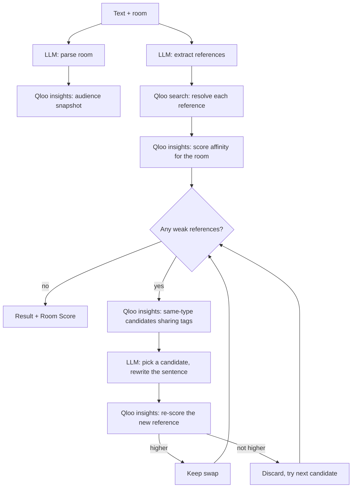

# Read the Room

> Every joke, ad and speech is written for a room the writer has never been in.

**Read the Room** is an agent that rewrites a speech, comedy set, sales pitch or ad so its cultural references land with the audience who will hear it. **Qloo's taste graph decides what lands. The LLM only finds references and writes sentences.**

**Live demo:** https://read-the-room-azure.vercel.app



## Judge in 60 seconds

1. Open the live URL. No login needed.
2. Click the **stand-up** example ("The nephew bit"). It loads instantly from a precomputed run.
3. Click a green **swapped** reference to see Qloo's numbers: affinity before and after, shared tags, and the candidates Qloo offered.
4. Flip the tab from **Qloo-grounded** to **LLM only** to see what a plain LLM guesses without taste data.
5. Scroll to **Who it lands with** and click **See who it lands with**: a heatmap of the same references scored by Qloo for each age group and gender. The wedding toast written for Chicago 55+ lands best with 25–34s (95 vs 65).
6. Click **Compare with another room** to see the same text tuned for two audiences side by side.

## What Qloo decides vs what the LLM writes

| Qloo decides | The LLM writes |
|---|---|
| Which references exist in the taste graph (`/search`) | Finding references in the text |
| How strongly each one lands with this room (affinity, `/v2/insights`) | Turning "Atlanta, ages 45–60" into room signals |
| Which replacements fit: same type, shared tags, strong for the room | Choosing among Qloo's candidates for the best fit in the sentence |
| Whether the rewrite improved: every swap is re-scored and kept only if it scores higher | Writing the new sentence in the same tone and length (±10%) |

The LLM never produces an affinity number and can only pick a replacement from Qloo's candidate list, and both rules are validated in code. A reference Qloo doesn't know is shown in grey as "no data" and left out of the Room Score.

## How the agent works



The loop runs for at most 3 rounds and within a budget of 20 Qloo calls per run, and every step streams to the UI timeline. Room Score is `round(100 × mean affinity)` over the references Qloo knows. A reference counts as strong at an affinity of 0.90 or more and weak below 0.80; these thresholds were calibrated in `docs/qloo-notes.md`.

## Qloo endpoints and parameters

| Call | Endpoint | Key parameters |
|---|---|---|
| Resolve a reference | `GET /search` | `query`, `types`, `take` |
| Score references for the room | `GET /v2/insights` | `filter.type`, `filter.results.entities`, `signal.location.query`, `signal.demographics.age`, `signal.demographics.gender`, `signal.interests.entities` |
| Find swap candidates | `GET /v2/insights` | `filter.type`, `filter.tags`, `operator.filter.tags` (intersection, then union), `filter.exclude.entities`, room signals, `take` |
| Audience snapshot | `GET /v2/insights` | `filter.type` (TV, artist, movie, brand), room signals, `take=5` |
| Who it lands with (heatmap) | `GET /v2/insights` | `filter.type`, `filter.results.entities`, `signal.demographics.age` or `signal.demographics.gender` (no location, so global names aren't filtered out) |

Example: score two TV shows for Atlanta, ages 45–60.

```bash
curl -G "https://hackathon.api.qloo.com/v2/insights" \
  -H "X-Api-Key: $QLOO_API_KEY" \
  --data-urlencode "filter.type=urn:entity:tv_show" \
  --data-urlencode "filter.results.entities=<entity-id-1>,<entity-id-2>" \
  --data-urlencode "signal.location.query=Atlanta" \
  --data-urlencode "signal.demographics.age=45_to_54,55_and_older"
```

Responses are cached for 7 days by query string, and only calls that miss the cache count toward the budget.

## Who it's for

- **Touring comedians:** retune the same set for each city.
- **Agencies:** localize one campaign across markets.
- **Wedding-toast writers:** match references to the family in the room.
- **Speakers and sales teams:** tune a pitch to the client's audience.

## Public API

```bash
curl -X POST https://<your-app>/api/v1/rewrite \
  -H "Content-Type: application/json" \
  -d '{"text":"This deal is like Blockbuster in 2005: everyone is about to switch.","room":"Brooklyn, ages 25-34"}'
```

The response is JSON (`RunResult`) with `finalText`, `roomScoreBefore`, `roomScoreAfter`, each reference with its Qloo affinity and status, and each swap with its re-scored affinity. Text can be up to 2,500 characters and the room up to 200. It uses the same rate limits as the web app. See `/developers` for details.

## Local setup

```bash
git clone <this repo> && cd read-the-room
npm install
cp .env.example .env.local   # fill in QLOO_API_KEY and GEMINI_API_KEY (or ANTHROPIC_API_KEY)
npm run dev                  # http://localhost:3000
```

| Script | What it does |
|---|---|
| `npm run precompute` | Runs the 5 demo examples and saves them (to Redis when configured, plus git-ignored `data/demos/`) |
| `npm run run-agent "<text>" "<room>"` | Prints a before/after report in the terminal |
| `npm run probe` | Qloo API probe used to calibrate thresholds |
| `npm test`, `npm run typecheck`, `npm run lint`, `npm run build` | Checks |

**LLM:** set `GEMINI_API_KEY` to use the Gemini free tier (`GEMINI_MODEL`, default `gemini-3.5-flash-lite`). If it is not set, the app uses `ANTHROPIC_API_KEY` with `LLM_MODEL`.
**Storage:** set `UPSTASH_REDIS_REST_URL` and `UPSTASH_REDIS_REST_TOKEN` for persistent cache, demos, share links and rate limits. Without them, the app uses an in-memory store that resets on restart.

## Limitations

- **Qloo coverage gaps:** references Qloo can't resolve show as "no data" and are never guessed.
- **Location skews toward local favourites:** when a room has a city, Qloo leaves out entities that aren't locally distinctive. These are shown as "not a standout" and count as weak, so global stars can score low in a city room.
- **Call budget:** 20 Qloo calls per run, so very long texts may not get every weak reference swapped.
- **Age buckets are approximate:** "45–60" maps to the Qloo buckets it overlaps (`45_to_54,55_and_older`).
- **Places are scored but not swapped**, because swapping a city or landmark changes the meaning.
- **Gemini free tier:** about 15 requests per minute, so live runs may slow down under load. Google may use free-tier prompts to improve its products, so don't paste confidential text.
- **Demo data:** Qloo's terms don't allow storing its response data in a public repo, so precomputed demos live in Redis and in git-ignored `data/demos/` rather than in git.

## License

[MIT](LICENSE)
